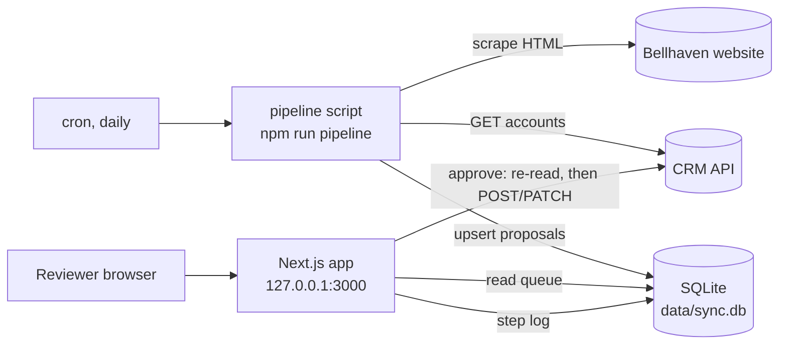

# Bellhaven CRM Sync: architecture

**Design:** `docs/superpowers/specs/2026-11-16-bellhaven-crm-sync-design.md`
Status: Draft

## 1. Overview

A standalone TypeScript pipeline scrapes the website, loads every CRM account, matches by address, and turns each location (and each stale account) into one proposal with its evidence and an ordered list of planned API writes. It stores them in SQLite, keyed by a fingerprint so re-runs never re-propose a decided item. A local Next.js app shows the queue; only an Approve click executes a proposal's writes, step by step, logging each call.

## 2. Stack and why

| Choice | Why | Rejected |
|---|---|---|
| TypeScript 5, Node 24 | User's pick; Node 24 ships `node:sqlite` and `fetch` | Python |
| Next.js 16.4 App Router (pinned `16.4.x`) | User's pick; Server Actions give approve/reject without a hand-written API | Hono single page |
| `node:sqlite` (built in) | No native build on Windows; sync API is fine for one local user | better-sqlite3 (native), JSON files |
| `cheerio` 1.x | Parses the site's simple HTML reliably; selectors are readable in a live edit | regex on HTML |
| `zod` 4 | Validates CRM responses and Server Action inputs at the boundary | hand-written guards |
| `tsx` | Runs the pipeline script and its `@/` imports without a build | Node type stripping (no path aliases) |
| Vitest 3, Playwright 1.5x | Unit/integration and one e2e flow | Jest |
| No auth, no hosting | Design non-goal; app binds to 127.0.0.1 only | |

Next.js 16 gotcha (from `node_modules/next/dist/docs/01-app/01-getting-started/08-caching.md`): synchronous `node:sqlite` reads are treated as prerenderable. Every page that reads the DB calls `await connection()` first so it renders per request.

## 3. Data model

SQLite file `data/sync.db` (git-ignored), WAL mode, `busy_timeout = 5000` so the pipeline and the app can overlap. Schema is created idempotently on open (`CREATE TABLE IF NOT EXISTS`); no migration tool.

**runs**: `id INTEGER PK`, `started_at TEXT`, `finished_at TEXT NULL`, `locations INTEGER`, `accounts INTEGER`, `created INTEGER`, `refreshed INTEGER`, `suppressed INTEGER`, `superseded INTEGER`, `error TEXT NULL`.

**proposals**:
- `id TEXT PK` (short readable id, e.g. `p_7f3a1c`), `fingerprint TEXT UNIQUE NOT NULL`
- `type TEXT` (`confirmed | update_fields | reparent | chow | duplicate | create | stale | ambiguous`)
- `status TEXT` (`info | pending | approved | applied | failed | rejected | superseded`)
  - `info` for `confirmed` and `ambiguous` (nothing to write, never approvable)
- `location_slug TEXT NULL`, `account_ids TEXT` (JSON array, involved accounts)
- `title TEXT`, `summary TEXT`, `confidence REAL`
- `evidence TEXT` (JSON: website facts, each CRM account as read, match reasons, SOP check)
- `snapshot TEXT` (JSON: per account, the fields the writes depend on: touched fields + `parent_id`, `status`)
- `first_run INTEGER`, `last_run INTEGER`, `decided_at TEXT NULL`, `comment TEXT NULL`
- Index: `(status)`, `(type)`.

**steps** (planned writes, one row per API call): `proposal_id TEXT FK`, `idx INTEGER`, `method TEXT` (`POST | PATCH`), `account_id TEXT NULL` (NULL for POST), `body TEXT` (JSON; may contain the placeholder `"$created"` meaning the id returned by this proposal's POST step), `status TEXT` (`pending | done | failed`), `result_account_id TEXT NULL`, `response TEXT NULL`, `error TEXT NULL`, `attempted_at TEXT NULL`. PK `(proposal_id, idx)`.

Access rules: single local user; the DB is only reachable by code on this machine. The app never accepts write bodies from the browser: steps come only from the DB.

### Fingerprint and suppression
`fingerprint = sha256(type + sorted account ids + location slug + canonical JSON of every step's method/account/body)`. On each run:
- fingerprint exists with status in `approved | applied | failed | rejected` → skip (suppressed).
- exists as `pending | info` → refresh evidence/snapshot, set `last_run`.
- new → insert as `pending` (or `info`).
- After the run, `pending`/`info` rows whose `last_run` < this run → `superseded`.

## 4. API surface

Server Actions in `app/actions.ts` (`'use server'`), inputs validated with zod:

| Action | Input | Effect | Errors (returned as `{ok:false, message}`) |
|---|---|---|---|
| `approve` | `id: string`, `comment?: string ≤ 500` | `pending → approved`, then `applyProposal(id)` → `applied` or `failed` | not found; not pending; CRM changed since proposal; CRM call failed (step + `detail`) |
| `reject` | `id`, `comment?` | `pending → rejected` | not found; not pending |
| `retry` | `id` | `failed → approved`, re-run remaining steps | not found; not failed |

Each action calls `revalidatePath` for `/` and the proposal page. Status transitions use a conditional `UPDATE … WHERE status = ?` so a double click can't apply twice.

No route handlers. The pipeline is a CLI: `npm run pipeline` (`tsx scripts/pipeline.ts`), exit code 0 on success, non-zero on scrape/CRM failure (nothing written to `proposals` on a failed run; the run row records the error).

### CRM client (`src/crm/client.ts`, server only)
`listAccounts()` (paginates `page_size=100` until `total`), `getAccount(id)`, `createAccount(body)`, `patchAccount(id, body)`, `findAccounts({street, zip})`. Bearer token from `CRM_TOKEN`. Retries GETs on 5xx/network errors (3×, backoff); never retries POST blindly (see lost-POST rule). Error → `CrmError {status, detail}`.

### Apply algorithm (`src/apply/apply.ts`)
1. Load steps; if any step is `done`, this is a retry, so skip the snapshot check for accounts those steps touched.
2. Re-read each involved account; compare to `snapshot`; on mismatch → fail with "CRM changed since this proposal was made. Run the pipeline again."
3. Run pending steps in order. A POST step first calls `findAccounts` at that street/zip for `created_by_candidate` accounts whose note contains `[bellhaven-sync <proposal id>]`; if found, record its id instead of posting. Substitute `"$created"` in later bodies.
4. Each step's result is written before the next starts. On error: step `failed`, proposal `failed`, stop.

## 5. Auth and permissions

One role: the local reviewer. Enforcement points:
- Next binds to `127.0.0.1` (`next dev -H 127.0.0.1`, `next start -H 127.0.0.1`).
- Server Actions accept only an id and a comment; status preconditions are checked in SQL on the server. Next's Server Action origin check rejects cross-site posts.
- The CRM token lives only in `.env.local`, read in server-only modules (`import 'server-only'`); it never reaches the client bundle or logs.
- The pipeline cannot write to the CRM: its CRM client is constructed read-only (no create/patch methods exposed to `src/sync`).

## 6. Frontend structure

Routes: `/` (queue), `/proposals/[id]` (detail). Root layout holds the header (app name, last run time, link to CRM browser).

- **Queue page** (server component): counts strip; filter links by type/status as query params (`?type=chow&status=pending`), so state lives in the URL; a table (not cards) of proposals: type, facility, city/state, summary, confidence, status. Default filter: pending.
- **Detail page** (server component):
  - `OwnershipChain`: the memorable element, an inline SVG: `[old parent] ── [facility] ──▶ [Bellhaven]`; CHOW draws a fork (old account stays on old parent, new account under Bellhaven, dashed `chow_current_account` link); duplicates draw losers as greyed nodes pointing at the survivor.
  - `EvidenceTable`: website vs each CRM account, rows = fields, changed cells highlighted.
  - `MatchReasons`, `SopCheck` (revenue, AR, rule applied).
  - `PlannedWrites`: ordered list of calls in plain words plus the JSON body in a `
`.
  - `DecisionForm` (client component): comment textarea, Approve / Reject buttons using `useActionState`, pending state, result message. After a decision: `StepLog`.
- **UI library:** none. All controls are native (`<a>`, `<button>`, `<textarea>`, `
`): no menus, dialogs, comboboxes or tabs. See ADR-4.
- **Tokens** (CSS variables in `app/globals.css`, light and dark):

| Token | Light | Dark | Use |
|---|---|---|---|
| `--paper` | `#F7F8FA` | `#14171C` | page |
| `--surface` | `#FFFFFF` | `#1B1F26` | tables, panels |
| `--ink` | `#1E2430` | `#E6E9EF` | text |
| `--muted` | `#5D6677` | `#9AA3B2` | secondary text |
| `--rule` | `#D9DEE7` | `#2C323D` | borders |
| `--approve` | `#0E6B5B` | `#3FB59D` | approve, applied |
| `--reject` | `#A23A2C` | `#E07A6B` | reject, failed |
| `--changed` | `#FFF1C2` | `#4A3F14` | highlighted changed cells |
| `--link` | `#2457A6` | `#8DB4F0` | links, chain edges |

  Type: **Public Sans** (variable, via `next/font/google`) for all UI; tabular numerals for money and counts. Account ids in `ui-monospace` only because they are codes. Scale (px): 13 / 15 (body) / 18 / 23 / 29. Spacing on a 4px grid; radius 6px on panels, 4px on badges. Left-aligned throughout; max content width 1180px; the evidence table scrolls horizontally inside its panel at 375px.

## 7. Cross-cutting

- **Validation:** zod at three boundaries: CRM responses (`AccountSchema`), scraped location (`LocationSchema`: required name, street, city, 2-letter state, 5-digit zip, ≥1 offering), Server Action inputs. A scraped location failing validation fails the run (better than silently dropping a facility).
- **Errors:** pipeline logs one line per phase and exits non-zero on failure. The app shows the CRM's `detail` verbatim next to the failed step, plus what to do ("Fix and retry", "Run the pipeline again").
- **States:** empty queue ("No pending proposals. Run `npm run pipeline` to check for changes."); no runs yet; failed proposal banner; pending button state during apply.
- **Accessibility:** WCAG AA: contrast checked for all token pairs, visible focus ring (`--link`, 2px), the chain SVG has a text equivalent (`<title>` + the summary sentence), status is never color-only (text labels).
- **Security:** see §5; React escapes scraped strings; no `dangerouslySetInnerHTML`; log lines never include headers.
- **Performance:** ~40 proposals; no budget concerns. The pipeline makes ~4 website requests + ~35 detail pages + 2 CRM list calls; it fetches detail pages with concurrency 4.
- **Observability:** `runs` table + `logs/pipeline.log` (cron redirect); step log per proposal.

## 8. Testing strategy

- **Fixtures:** `test/fixtures/accounts.json` and `test/fixtures/site/*.html` (saved from the live sandbox on 2026-11-16, including a page-4 request that repeats page 3).
- **Unit (Vitest):** normalization (street suffixes, directions, PO box), matcher scoring, care-type mapping, survivor ranking, SOP branch, fingerprint stability.
- **Classification table test:** runs scrape-parse + classify on fixtures and asserts every expected outcome listed in the design's Recon section (types, survivors, CHOW vs reparent, lookalikes not matched).
- **Pipeline idempotency:** run the pipeline twice against fixtures + temp DB → second run creates 0; approve/reject some, run again → those are suppressed; change a fixture field → a new proposal appears and the old pending one is superseded.
- **Apply (integration):** an in-memory fake CRM implementing the 5 client methods: happy path for each type; CHOW POST ok + PATCH fail → retry resumes without a second POST; lost POST response → found by marker; snapshot mismatch → refused.
- **E2E (Playwright):** the app runs against a seeded temp DB and a small fake CRM HTTP server (`CRM_API_BASE` pointed at it): open queue → open proposal → approve → see "Applied" and the step log; reject another → status Rejected; reload → state persists.
- **CI:** GitHub Actions on push: `npm ci`, typecheck, lint, Vitest, Playwright (Chromium).

## 9. Deployment

Local only. Env vars (`.env.example`): `CRM_API_BASE`, `CRM_TOKEN`, `SITE_BASE`, `BELLHAVEN_PARENT_NAME` (default `Bellhaven Senior Living (Parent Account)`; resolved to an id at run start, and the run fails if not exactly one match), `DB_PATH` (default `data/sync.db`).
- Schedule: `deploy/crontab` with `0 6 * * * cd /opt/bellhaven-crm-sync && npm run pipeline >> logs/pipeline.log 2>&1`. Reference `.github/workflows/daily-sync.yml` with a header comment that it needs a shared DB to be useful.
- Rollback: CRM writes can't be rolled back automatically; every applied step's prior values are in the proposal snapshot, so a manual PATCH can restore them. The step log is the audit trail.

## 10. Decisions (ADRs)

1. **SQLite via `node:sqlite`.** Why: durable decision memory and per-step log, no native build. Cost if wrong: swap the small `src/store` module for Postgres.
2. **One proposal per location (bundled writes).** Why: no half-fixed facilities, no ordering between proposals. Cost if wrong: a reviewer who wants to approve only part of a bundle must reject it and fix by hand.
3. **Address-first deterministic matching, no LLM.** Why: explainable evidence, testable on fixtures, free. Cost if wrong: an unusual rename at a new address is surfaced as `create` + `stale` instead of a match. The reviewer sees both and can reject.
4. **No component library (my call).** Why: the UI needs only native buttons, links, a textarea and `
`; UI SDK is beta and adds a dependency for nothing here. Cost if wrong: adding dialogs later means adopting one then.
5. **Pipeline is read-only against the CRM.** Why: "nothing writes without approval" is enforced by structure, not discipline. Cost if wrong: none.
6. **Snapshot-field comparison, not `updated_at`.** Why: every write bumps `updated_at`, including our own earlier steps. Cost if wrong: an unrelated field change slips through, which is harmless.
7. **cron over GitHub Actions.** Why: the review DB is local. Cost if wrong: move the DB to a hosted store.

## 11. Risks and open questions

- **Live data drift before submission** (owner: builder, at run time): the sandbox may differ from the fixtures; fixtures pin logic, and the real run's queue is reviewed by hand anyway.
- **Time budget** (owner: user): the brief expects ~2 hours; this plan is larger. The writeup states the real time.
- **Next 16 API differences** (owner: builder, during build): read the bundled docs before each Next file; `params` is a Promise, `connection()` before DB reads.
- **Matching thresholds** (owner: builder, during build): tuned against fixtures; anything below threshold becomes `ambiguous`, never a write.
